# compose-cast

[](https://github.com/ljarka/compose-cast/actions/workflows/ci.yml)

**compose-cast** is an open-source server-driven UI framework for Android built on top of
[Remote Compose](https://developer.android.com/jetpack/compose/remote-compose) (AndroidX).

Screens are defined in a Kotlin DSL on the server, rendered to Remote Compose binary documents
and played natively on Android by the Remote Compose player — no app update needed to change a
screen.

> **Status: experimental.** Built on `androidx.compose.remote` **1.0.0-alpha23**, whose creation
> and player APIs are marked `@RestrictTo(LIBRARY_GROUP)` and may change between alphas. The
> whole project depends on that API staying usable; see the risk note in
> [ADR 0002](docs/decisions/0002-confine-restricted-remote-compose-api.md).

## Vision

**A self-hosted platform where anyone builds their own Android app without writing code:**
screens, navigation, data and brand are defined in an admin panel on the owner's own server
(today: JSON files and a Kotlin DSL), data comes from any HTTP API bound on the server, and a thin
Android app renders it natively with AndroidX Remote Compose. **Android only**
([ADR 0022](docs/decisions/0022-android-only.md)), open source, one server = one product.

Mission, audience, principles and non-goals: **[specs/mission.md](specs/mission.md)** · how it is
built: [specs/tech-stack.md](specs/tech-stack.md) · what comes next: [specs/roadmap.md](specs/roadmap.md).

### DivKit concepts → Remote Compose → compose-cast

| DivKit concept | Remote Compose primitive (alpha) | compose-cast |
|---|---|---|
| Element tree (containers, text, image) | `Column`/`Row`/`Box`/`Flow`, `Text`, `Image`, `Canvas` | Text, Image, Button, Icon, Divider, Card, Column/Row/Box, Flow, grids, galleries + modifiers ✅; Canvas: `gauge`, `sparkline`, `kpi` ✅ (T-047), charts ⏳ T-018 |
| Templates | Server-side Kotlin functions; RC macros (`defineMacro`/`inflate`) | ⏳ Etap 10 |
| Variables | Named variables, set by the host (`setUserLocal*` on the player) | ⏳ Etap 10 |
| Expressions | On-device float/text expressions, conditional operations | used internally for dp/sp; DSL ⏳ Etap 10 |
| States | `StateLayout` + local value-change actions | `expandable` (T-008 PoC) ✅; general states & tabs ⏳ Etap 10 (T-017) |
| Actions | Host actions (named) + local value changes | typed `Action` (navigate with params, open_url, reload, track, custom) ✅ |
| Light/dark, theming | Themed colors in the document | ⏳ Etap 7 |
| Custom elements / extensions | `Custom` component + player custom support | ⏳ later |
| Loading new markup without release | Whole document per request; player `updateDocument` | ✅ per screen; live data-update documents over a WebSocket ⏳ T-047 ([ADR 0029](docs/decisions/0029-live-screens-websocket-data-updates.md)) |
| Data from APIs | — (server-side) | data sources ✅ (Etap 4) |
| Visibility actions (analytics) | no equivalent found | ⏳ SDK-side, Etap 7 |
| Platforms: Android, iOS, web, KMP | official player: Android only | Android ✅ (only target, ADR 0022) |
| Playground / editor | — | `/debug` dump ✅; admin panel with preview ⏳ Etap 8 |

## Screenshots

The demo screens from [`demo/`](server-app/src/main/kotlin/io/composecast/server/demo/),
rendered to Remote Compose documents by the server SDK and played by the Android SDK's
`RemoteComposePlayer`:

<table>
  <tr>
    <td align="center">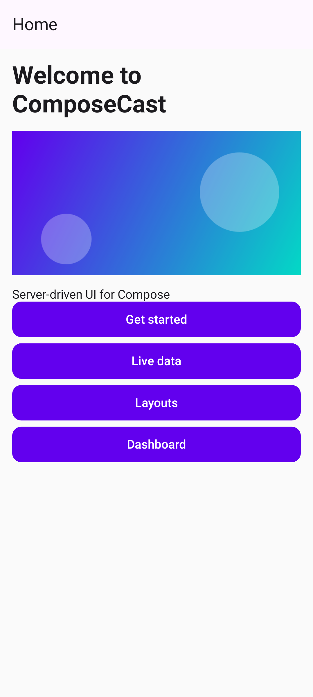<br><code>main</code></td>
    <td align="center">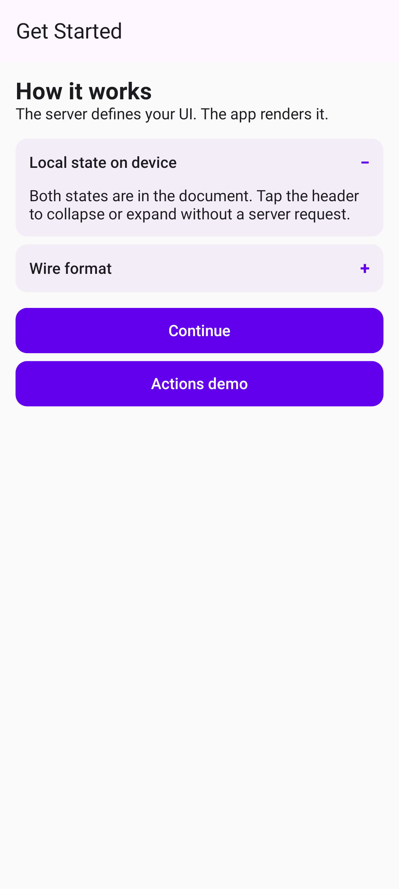<br><code>onboarding</code></td>
    <td align="center">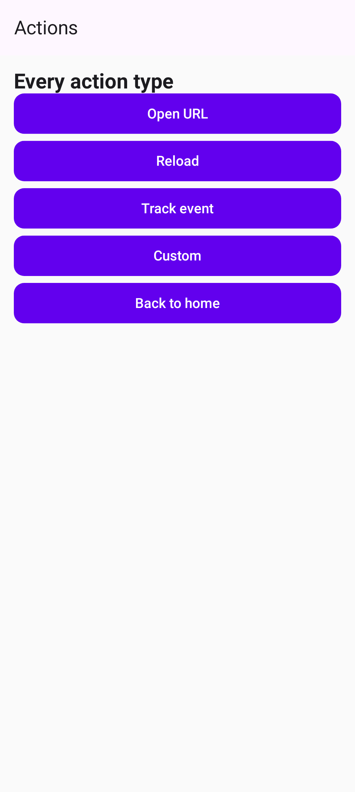<br><code>actions</code></td>
    <td align="center">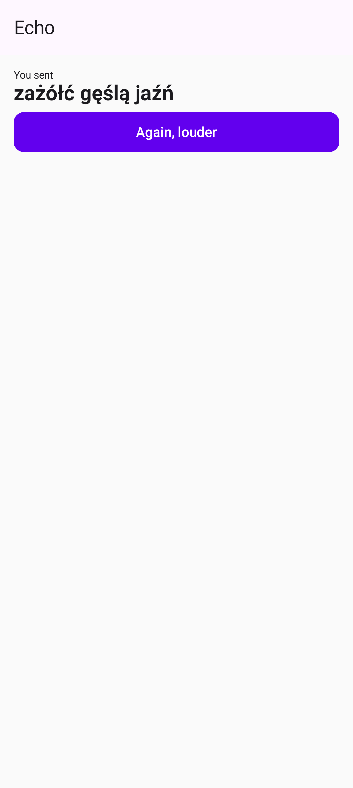<br><code>echo?word=…</code></td>
  </tr>
  <tr>
    <td align="center">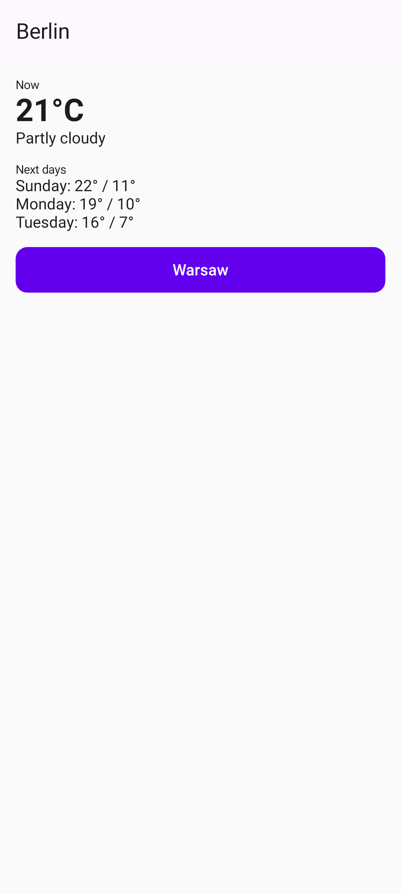<br><code>data</code> (fixture data)</td>
    <td align="center">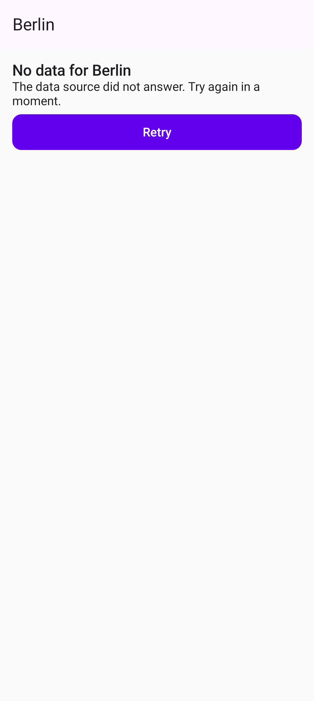<br><code>data</code>, source down</td>
    <td align="center">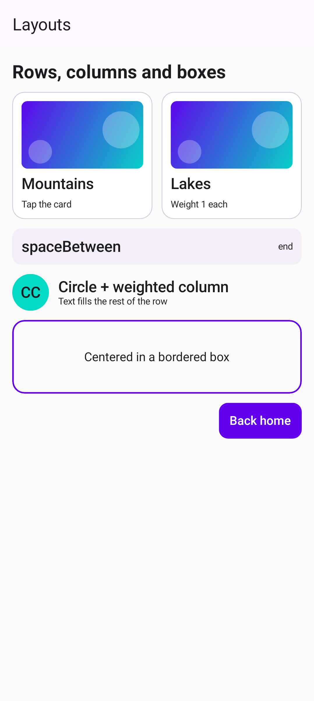<br><code>layouts</code></td>
    <td align="center">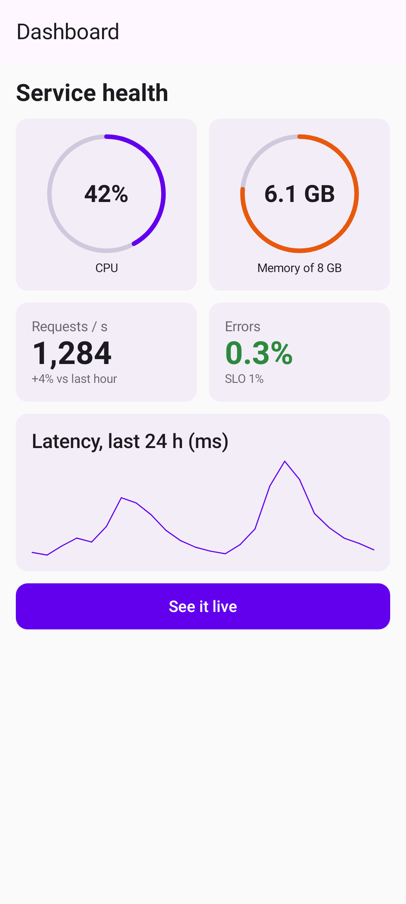<br><code>dashboard</code></td>
  </tr>
</table>

These images are the golden files of the screenshot tests in `compat-tests`
(Robolectric + [Roborazzi](https://github.com/takahirom/roborazzi), no emulator or network;
remote images are replaced by a generated gradient). CI fails when rendering changes.

```bash
./gradlew :compat-tests:verifyRoborazziDebug   # compare with the goldens
./gradlew :compat-tests:recordRoborazziDebug   # accept intentional changes, then commit the PNGs
```

### Example app: Weather (Milestone 1, T-025)

A separate app repository, [ljarka/weather-app](https://github.com/ljarka/weather-app), using compose-cast like any product would: 4 JSON screens, live
[Open-Meteo](https://open-meteo.com) data through data sources, an Android app with no Kotlin
(`compose-cast.properties` + the `io.composecast.app` plugin). On the emulator against the server
in Docker, 2026-11-18:

<table>
  <tr>
    <td align="center">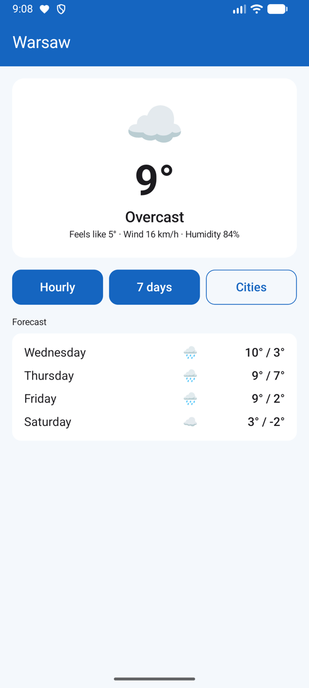<br><code>main</code></td>
    <td align="center">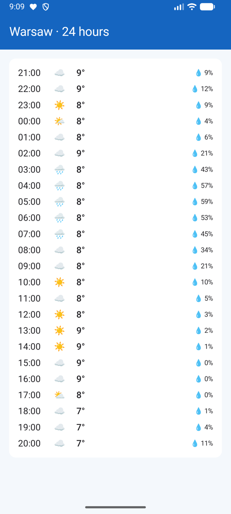<br><code>hourly</code></td>
    <td align="center">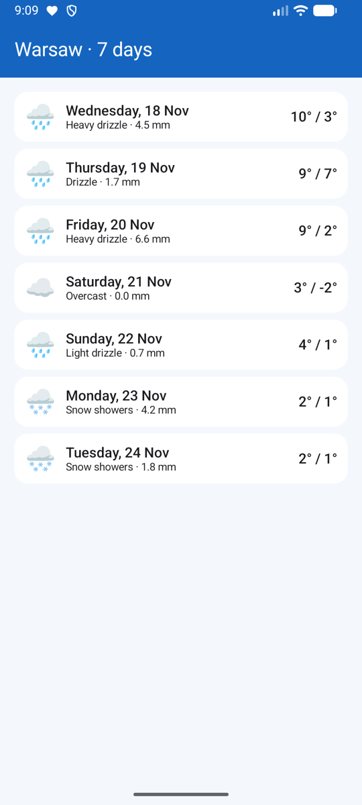<br><code>daily</code></td>
    <td align="center">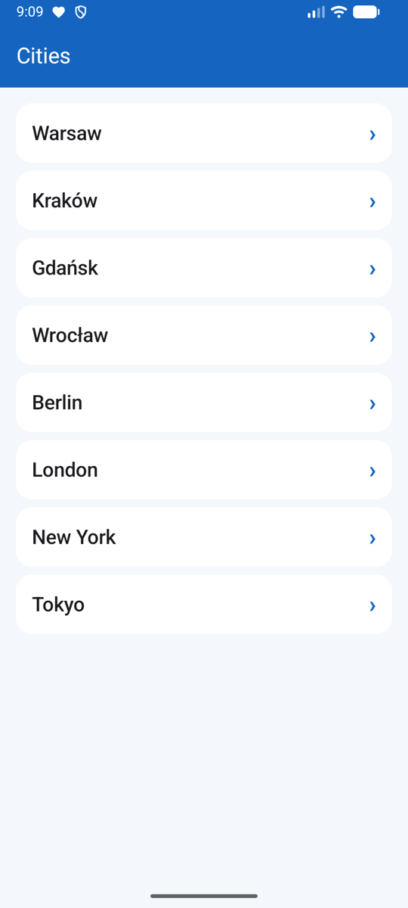<br><code>cities</code></td>
  </tr>
</table>

### Performance

The weather app's server (Docker on an Apple-silicon Mac, `ab -c 10`, 2026-11-18):

| Measurement | Result |
|---|---|
| `GET /screens/main`, data cached (1,000 requests) | p50 3 ms, p95 6 ms, p99 9 ms, ~2,600 req/s |
| `GET /screens/main`, cache miss (40 places → Open-Meteo each time) | p50 47 ms, p95 53 ms |
| Document size | `main` 3.1 KB, `hourly` (24 rows) 9.0 KB, `daily` 4.2 KB, `cities` 3.2 KB |
| Memory, `-Xmx128m`, 12,000 requests | RSS steady at 253–261 MB, no errors |
| Memory, image default (`MaxRAMPercentage=75`) | RSS grows with load (930 MB after 4,500 requests on a 6.8 GB VM) — heap ergonomics, not a leak: cap it with `JAVA_OPTS` on a small VPS ([install-server](docs/playbooks/install-server.md#settings-env)) |

## Architecture

```
┌──────────────────────────── Server (JVM) ────────────────────────────┐
│  server-app (Ktor)  ──►  sdk-server: DSL → Remote Compose document    │
│                          (images fetched and embedded at render time) │
│  server-scripting (.screen.kts, planned)      protocol (shared types) │
└───────────────────────────────────────────────────────────────────────┘
                                  │  HTTP: application/octet-stream
                                  ▼  (Remote Compose binary document)
┌──────────────────────────── Android ─────────────────────────────────┐
│  app-template  ──►  sdk-android  ──►  RemoteComposePlayer             │
│                     button taps come back as host actions,            │
│                     e.g. "navigate:onboarding"                        │
└───────────────────────────────────────────────────────────────────────┘
```

## Defining screens

```kotlin
val registry = composeCast {
    brand(name = "ComposeCast Demo", primaryColor = "#6200EE", secondaryColor = "#03DAC6")

    screen("main") {
        title = "Home"
        text("Welcome to ComposeCast", style = "h1")   // h1 | h2 | h3 | body | caption
        image("https://picsum.photos/400/200", alt = "Hero image")
        expandable("How it works") { text("Toggled locally on the device — no server request.") }
        button("Get started", action = "navigate:onboarding")
        row(spacing = 12) {                                // column | row | box (ADR 0020)
            column(modifier = Modifier(weight = 1f, padding = Padding(12), background = "#FFFFFF",
                cornerRadius = 16, border = Border(1, "#D0C8DC"), action = Action.Navigate("detail"))) {
                text("Card", style = "h3")
            }
        }
    }
}
```

Actions are typed (`io.composecast.protocol.Action`): `Action.Navigate("movie", mapOf("id" to "42"))`,
`OpenUrl`, `Reload`, `Track`, `Custom`. The wire form also works as a string:
`navigate:<screen>`, `open_url:<url>`, `reload:`, `track:<event>`, `custom:<payload>`.
Containers (`column`, `row`, `box`) and one `modifier` on every component — size, weight, padding,
background, rounded/circle clip, border, tap action — follow a fixed box model
([ADR 0020](docs/decisions/0020-component-tree-and-modifiers.md); JSON form in `protocol/AGENTS.md`).
Invalid definitions (unknown style or action, duplicate id, bad color, `weight` outside a row or
column, nesting deeper than 32) fail at server start with the JSON path.

Screens can depend on the request: `dynamicScreen` is rendered per request from the query
parameters that `Action.Navigate` params become (`GET /screens/echo?word=hi`):

```kotlin
dynamicScreen("echo") { ctx ->
    text(ctx.param("word"), style = "h2")   // missing ?word= → HTTP 400
    button("Again, louder", Action.Navigate("echo", mapOf("word" to ctx.param("word") + "!")))
}
```

Demo screens live in `server-app/src/main/kotlin/io/composecast/server/demo/` (one file per screen, registered in `Screens.kt`).

The DSL builds a serializable `ScreenDefinition`; the same screens can be JSON files, one
`<id>.json` per screen, loaded with `composeCast { screensFrom(Path.of("screens")) }`:

```json
{
  "id": "main",
  "title": "Home",
  "components": [
    { "type": "text", "text": "Welcome to ComposeCast", "style": "h1" },
    { "type": "image", "url": "https://picsum.photos/400/200", "alt": "Hero image" },
    { "type": "button", "label": "Get started", "action": { "type": "navigate", "screen": "onboarding" } }
  ]
}
```

Both paths render byte-identical documents (`JsonScreensTest`). JSON errors name the file and the
JSON path, e.g. `main.json: … subclass 'carousel' is not found … at path: $.components[1]`.
Format reference: [docs/screen-json-format.md](docs/screen-json-format.md).

### Data from external APIs

A screen can declare HTTP **data sources** and bind fields to the JSON responses — no Kotlin, so
the same works from a JSON file or (later) the admin panel. The server fetches (in parallel, with
per-source timeout and cache), binds and renders per request; API keys never reach the app
([ADR 0008](docs/decisions/0008-server-side-data-sources.md)):

```json
{
  "id": "weather",
  "title": "{{params.city}}",
  "params": { "lat": { "default": "52.52" }, "lon": { "default": "13.41" }, "city": { "default": "Berlin" } },
  "data": { "meteo": { "url": "https://api.open-meteo.com/v1/forecast?latitude={{params.lat}}&longitude={{params.lon}}&current=temperature_2m,weather_code&daily=temperature_2m_max,temperature_2m_min&timezone=auto", "cacheSeconds": 600 } },
  "lookups": { "wmo": { "0": "Clear sky", "3": "Overcast", "*": "Changing weather" } },
  "components": [
    { "type": "text", "style": "h1", "text": "{{meteo.current.temperature_2m | round}}{{meteo.current_units.temperature_2m}}" },
    { "type": "text", "text": "{{meteo.current.weather_code | lookup:wmo}}" },
    { "type": "repeat", "as": "d", "limit": 3,
      "items": { "day": "meteo.daily.time", "max": "meteo.daily.temperature_2m_max" },
      "template": [ { "type": "text", "text": "{{d.day | date:'EEEE'}}: {{d.max | round}}°" } ] }
  ],
  "error": [ { "type": "button", "label": "Retry", "action": { "type": "reload" } } ]
}
```

`GET /screens/weather?lat=52.23&lon=21.01&city=Warsaw` changes the data. Filters: `round`, `date`,
`lookup`, `default`, `upper`, `lower`, `append` (arguments may be paths: lookups by two values, T-041); secrets as `{{secret.KEY}}` from `COMPOSECAST_SECRET_KEY`
(source URLs/headers only). Full grammar: [docs/screen-json-format.md](docs/screen-json-format.md#data-sources-and-bindings-t-006);
live demo: `examples/demo/screens/data.json` ("Live data" on the home screen).

## Modules

| Module | Description |
|---|---|
| `protocol` | Screen model (`ScreenDefinition`, JSON format), typed actions, headers, brand types |
| `sdk-server` | DSL that renders screens to Remote Compose documents |
| `server-scripting` | `.screen.kts` script host for hot-reloadable screens (planned) |
| `server-app` | Ktor HTTP server |
| `sdk-android` | Fetches documents and plays them with the Remote Compose player |
| `app-shell` | The Android app itself (activity, back stack, states, action routing) as a library |
| `gradle-plugins` | `io.composecast.app` Gradle plugin: `compose-cast.properties` → branded app |
| `app-template` | Demo Android app built like an app repository (plugin + properties) |
| `compat-tests` | Screenshot tests: server document → Android player, golden PNGs used in this README |

## Quick start

**Deploying an app's backend** (VPS, no clone or build — like Immich): see the
[install playbook](docs/playbooks/install-server.md):
`docker-compose.yml` + `.env` from GitHub Releases, image `ghcr.io/ljarka/compose-cast-server`,
optional HTTPS with Caddy.

Developing compose-cast itself:

Server with Docker — no JDK, Gradle or Kotlin needed (serves the JSON screens in `examples/demo`):

```bash
docker compose up -d
curl http://localhost:8080/screens                 # ["actions","adaptive","collections","components","dashboard","data","layouts","main","onboarding"]
COMPOSECAST_SCREENS=/path/to/data docker compose up -d   # your own screens/<id>.json + brand.json
docker compose logs server                         # edits are reloaded within ~3 s; an invalid file is reported here (file + JSON path)
```

The image (`server-app/Dockerfile`) is multi-arch: `docker buildx build --platform
linux/amd64,linux/arm64 -f server-app/Dockerfile .`

Server from source (built-in demo screens from `Screens.kt`):

```bash
./gradlew :server-app:run
curl http://localhost:8080/screens                 # main, layouts, data, onboarding, actions, components, … (Screens.kt)
curl http://localhost:8080/screens/main/debug      # human-readable document tree
```

Without Kotlin — serve screens from JSON files (`<dir>/screens/<id>.json`, optional
`<dir>/brand.json`; an invalid file stops startup with the file and JSON path):

```bash
COMPOSECAST_DATA_DIR=examples/demo ./gradlew :server-app:run    # PORT=8080 by default
```

| Endpoint | Response |
|---|---|
| `GET /health` | `ok` |
| `GET /brand` | Brand JSON |
| `GET /screens` | JSON list of screen ids |
| `GET /screens/{id}?k=v` | Remote Compose document; query = screen params; title in `X-Composecast-Screen-Title`; `ETag` (`If-None-Match` → `304`) |
| `GET /screens/{id}/debug` | Decoded document as text |

Android (emulator; it reaches the server at `http://10.0.2.2:8080`):

1. Keep the server running.
2. Open the project root in Android Studio and run the **app-template** configuration,
   or `./gradlew :app-template:installDebug`.

Cleartext HTTP is allowed only in debug builds and only for local addresses.

### Make your own app

An Android app is **one Gradle plugin and one properties file — no Kotlin**: copy
[`distribution/android-app/`](distribution/android-app) into your app's repository and follow the
[new app repository playbook](docs/playbooks/new-app-repository.md). `compose-cast.properties`
holds everything that differs between apps: name, `applicationId`, server URL, native frame colors
and an optional launcher icon; the `io.composecast.app` plugin adds the app shell
(`io.composecast:app-shell`). Inside this repository the demo app is built the same way, and any
other properties file can be pointed at it:

```bash
./gradlew :app-template:installDebug -Pcomposecast.appConfig=../my-app/compose-cast.properties
```

Apps with different `applicationId`s install side by side. A missing or invalid key fails the build
and names the key. Release builds require an `https://` server URL. Screen content colors come
from the server's brand (`GET /brand`), not from this file.

## Requirements

- JDK 21
- Android SDK with platform 37 (installed automatically by the Android Gradle Plugin)
- Android 8.0 (API 26) or newer on the device

## Roadmap

The plan — small steps toward "a non-developer ships an app" — is in
**[specs/roadmap.md](specs/roadmap.md)** (with the [mission](specs/mission.md) and the
[tech stack](specs/tech-stack.md)). What already works, feature by feature:
[docs/feature-checklist.md](docs/feature-checklist.md).

## References

- [DivKit — the model this project follows](https://divkit.tech/docs/en/)
- [Open-Meteo](https://open-meteo.com), [TVMaze API](https://www.tvmaze.com/api) — keyless APIs for the sample apps
- [Remote Compose — official guide](https://developer.android.com/develop/ui/compose/system/remote-compose)
- [AndroidX releases — compose-remote](https://developer.android.com/jetpack/androidx/releases/compose-remote)
- [armcha/remotecompose — web editor + JVM converter + Android player](https://github.com/armcha/remotecompose)
- [camaelon/remotecompose-experiments — multi-platform players](https://github.com/camaelon/remotecompose-experiments)
- [android/skills — AI-optimised Android skill files](https://github.com/android/skills)

## License

Apache 2.0 — see [LICENSE](LICENSE).
