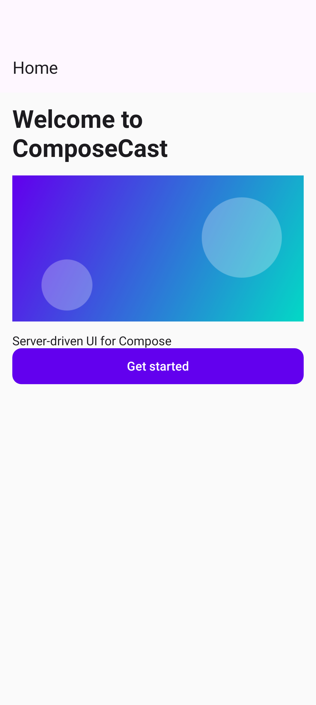
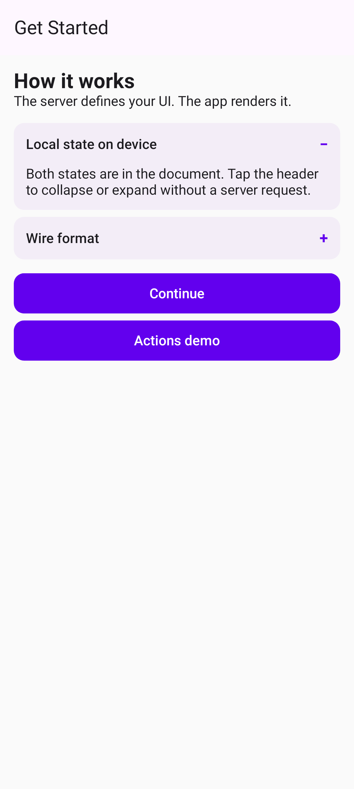
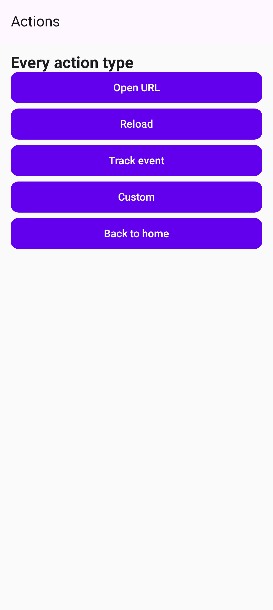

# compose-cast

**compose-cast** is an open-source server-driven UI framework for Android built on top of
[Remote Compose](https://developer.android.com/jetpack/compose/remote-compose) (AndroidX).

Screens are defined in a Kotlin DSL on the server, rendered to Remote Compose binary documents
and played natively on Android by the Remote Compose player — no app update needed to change a
screen.

> **Status: experimental.** Built on `androidx.compose.remote` **1.0.0-alpha23**, whose creation
> and player APIs are marked `@RestrictTo(LIBRARY_GROUP)` and may change between alphas.

## Vision

**A DivKit-style framework for apps whose entire UI is controlled by the server** — screens,
navigation and content are defined on the server (Kotlin DSL, later an admin panel), data comes
from any HTTP API bound on the server, and Android/iOS apps render it natively.

[DivKit](https://divkit.tech) defines its own JSON format and ships a renderer per platform.
compose-cast builds on **AndroidX Remote Compose** instead: on Android the server sends RC binary
documents and the official RC player renders them, including the runtime primitives DivKit is
known for (variables, expressions, states, local actions, animation). Remote Compose has no
official iOS player yet, so the iOS renderer is being decided by a spike
([ADR 0007](docs/decisions/0007-ios-strategy-spike.md)).

compose-cast is the product layer around the renderers:

- **Authoring** — Kotlin DSL and JSON files (✅); later `.screen.kts` scripts and an admin panel, all
  producing one serializable screen model (`ScreenDefinition`).
- **Data** — screens bind to external HTTP APIs through server-side data sources; the APIs are not
  part of the project and their keys never reach the app
  ([ADR 0008](docs/decisions/0008-server-side-data-sources.md)).
- **Delivery** — server renders per request and per client capability; starts with one command.
- **Apps** — thin shells (Android now, iOS next) whose UI is entirely server-driven.
- **Tooling** — debug dump, screenshot tests, preview, dev loop.

Principles:

1. The server's screen model is the product; wire formats are adapters. Android = Remote Compose,
   never a custom Android renderer ([ADR 0001](docs/decisions/0001-remote-compose-wire-format.md)).
2. A screen change must never break an app already in users' hands: the server renders for the
   capabilities the client reports.
3. Interaction runs on the device where possible (RC variables, expressions, states).
4. Backend starts with one command (`docker compose up`).
5. Everything visual is screenshot-tested; every decision is written down, so AI agents can
   maintain the project long-term ([ADR 0009](docs/decisions/0009-documentation-for-agents.md)).

### DivKit concepts → Remote Compose → compose-cast

| DivKit concept | Remote Compose primitive (alpha) | compose-cast |
|---|---|---|
| Element tree (containers, text, image) | `Column`/`Row`/`Box`/`Flow`, `Text`, `Image`, `Canvas` | Text, Image, Button, Spacer ✅; containers ⏳ Etap 5 |
| Templates | Server-side Kotlin functions; RC macros (`defineMacro`/`inflate`) | ⏳ Etap 10 |
| Variables | Named variables, set by the host (`setUserLocal*` on the player) | ⏳ Etap 10 |
| Expressions | On-device float/text expressions, conditional operations | used internally for dp/sp; DSL ⏳ Etap 10 |
| States | `StateLayout` + local value-change actions | ⏳ Etap 10 |
| Actions | Host actions (named) + local value changes | typed `Action` (navigate with params, open_url, reload, track, custom) ✅ |
| Light/dark, theming | Themed colors in the document | ⏳ Etap 7 |
| Custom elements / extensions | `Custom` component + player custom support | ⏳ later |
| Loading new markup without release | Whole document per request; player `updateDocument` | ✅ per screen; partial updates ⏳ investigate |
| Data from APIs | — (server-side) | data sources ⏳ Etap 4 |
| Visibility actions (analytics) | no equivalent found | ⏳ SDK-side, Etap 7 |
| Platforms: Android, iOS, web, KMP | official player: Android only | Android ✅; iOS ⏳ spike (Etap 3) |
| Playground / editor | — | `/debug` dump ✅; admin panel with preview ⏳ Etap 8 |

## Screenshots

The demo screens from [`Screens.kt`](server-app/src/main/kotlin/io/composecast/server/Screens.kt),
rendered to Remote Compose documents by the server SDK and played by the Android SDK's
`RemoteComposePlayer`:

<table>
  <tr>
    <td align="center"><br><code>main</code></td>
    <td align="center"><br><code>onboarding</code></td>
    <td align="center"><br><code>actions</code></td>
  </tr>
</table>

These images are the golden files of the screenshot tests in `compat-tests`
(Robolectric + [Roborazzi](https://github.com/takahirom/roborazzi), no emulator or network;
remote images are replaced by a generated gradient). CI fails when rendering changes.

```bash
./gradlew :compat-tests:verifyRoborazziDebug   # compare with the goldens
./gradlew :compat-tests:recordRoborazziDebug   # accept intentional changes, then commit the PNGs
```

## Architecture

```
┌──────────────────────────── Server (JVM) ────────────────────────────┐
│  server-app (Ktor)  ──►  sdk-server: DSL → Remote Compose document    │
│                          (images fetched and embedded at render time) │
│  server-scripting (.screen.kts, planned)      protocol (shared types) │
└───────────────────────────────────────────────────────────────────────┘
                                  │  HTTP: application/octet-stream
                                  ▼  (Remote Compose binary document)
┌──────────────────────────── Android ─────────────────────────────────┐
│  app-template  ──►  sdk-android  ──►  RemoteComposePlayer             │
│                     button taps come back as host actions,            │
│                     e.g. "navigate:onboarding"                        │
└───────────────────────────────────────────────────────────────────────┘
```

## Defining screens

```kotlin
val registry = composeCast {
    brand(name = "ComposeCast Demo", primaryColor = "#6200EE", secondaryColor = "#03DAC6")

    screen("main") {
        title = "Home"
        text("Welcome to ComposeCast", style = "h1")   // h1 | h2 | h3 | body | caption
        image("https://picsum.photos/400/200", alt = "Hero image")
        button("Get started", action = "navigate:onboarding")
    }
}
```

Actions are typed (`io.composecast.protocol.Action`): `Action.Navigate("movie", mapOf("id" to "42"))`,
`OpenUrl`, `Reload`, `Track`, `Custom`. The wire form also works as a string:
`navigate:<screen>`, `open_url:<url>`, `reload:`, `track:<event>`, `custom:<payload>`.
Invalid definitions (unknown style or action, duplicate id, bad color) fail at server start.
Demo screens live in `server-app/src/main/kotlin/io/composecast/server/Screens.kt`.

The DSL builds a serializable `ScreenDefinition`; the same screens can be JSON files, one
`<id>.json` per screen, loaded with `composeCast { screensFrom(Path.of("screens")) }`:

```json
{
  "id": "main",
  "title": "Home",
  "components": [
    { "type": "text", "text": "Welcome to ComposeCast", "style": "h1" },
    { "type": "image", "url": "https://picsum.photos/400/200", "alt": "Hero image" },
    { "type": "button", "label": "Get started", "action": { "type": "navigate", "screen": "onboarding" } }
  ]
}
```

Both paths render byte-identical documents (`JsonScreensTest`). JSON errors name the file and the
JSON path, e.g. `main.json: … subclass 'carousel' is not found … at path: $.components[1]`.
Format reference: [protocol/AGENTS.md](protocol/AGENTS.md#screen-json-format).

## Modules

| Module | Description |
|---|---|
| `protocol` | Screen model (`ScreenDefinition`, JSON format), typed actions, headers, brand types |
| `sdk-server` | DSL that renders screens to Remote Compose documents |
| `server-scripting` | `.screen.kts` script host for hot-reloadable screens (planned) |
| `server-app` | Ktor HTTP server |
| `sdk-android` | Fetches documents and plays them with the Remote Compose player |
| `app-template` | Demo Android app with navigation and back stack |
| `compat-tests` | Screenshot tests: server document → Android player, golden PNGs used in this README |

## Quick start

Server:

```bash
./gradlew :server-app:run
curl http://localhost:8080/screens                 # ["main","onboarding"]
curl http://localhost:8080/screens/main/debug      # human-readable document tree
```

| Endpoint | Response |
|---|---|
| `GET /health` | `ok` |
| `GET /brand` | Brand JSON |
| `GET /screens` | JSON list of screen ids |
| `GET /screens/{id}` | Remote Compose document; title in `X-Composecast-Screen-Title` |
| `GET /screens/{id}/debug` | Decoded document as text |

Android (emulator; it reaches the server at `http://10.0.2.2:8080`):

1. Keep the server running.
2. Open the project root in Android Studio and run the **app-template** configuration,
   or `./gradlew :app-template:installDebug`.

For a physical device change `SERVER_URL` in `app-template/.../MainActivity.kt`.
Cleartext HTTP is allowed only in debug builds and only for local addresses.

## Requirements

- JDK 21
- Android SDK with platform 37 (installed automatically by the Android Gradle Plugin)
- Android 8.0 (API 26) or newer on the device

## Roadmap

Ordered for the fastest path to real use: two milestones are complete apps (weather, TV shows)
that force every layer to work end to end. Details and reasoning: [docs/decisions](docs/decisions/README.md).

### Etap 0 — Technical Spike ✅
- [x] Verify `remote-creation-jvm` works on plain JVM
- [x] Generate and serve Remote Compose binary documents
- [x] Play `.rc` documents in Android with `RemoteComposePlayer`

### Etap 1 — Repository, CI, Tests & Docs ✅
- [x] Gradle multi-module structure; current toolchain (AGP 9.5, Gradle 9.6, Kotlin 2.4, Compose BOM)
- [x] GitHub Actions CI: build, lint, screenshot verification, docs check
- [x] Screenshot tests server → player (`compat-tests`), images in this README
- [x] Agent documentation: index `AGENTS.md`, ADRs, Remote Compose knowledge base, history
- [ ] ktlint config + badge

### Etap 2 — Foundations ⏳
- [x] Remote Compose alpha20 → alpha23 (units revised, [ADR 0004](docs/decisions/0004-units-dp-and-sp.md))
- [x] Typed actions with parameters (`navigate` with params, `open_url`, `reload`, `track`) — T-001
- [x] **Serializable screen model** (JSON) — one model for the DSL, JSON files, scripts and the admin panel — T-002 ([ADR 0015](docs/decisions/0015-screen-model-is-the-product.md))
- [ ] **Per-request rendering**: routes with parameters (`movie/{id}`), locale; today screens are
  pre-rendered once at start
- [ ] `ETag` / `If-None-Match`
- [ ] **Version negotiation**: client reports the RC document API level it plays (6–8 verified);
  server renders for it or answers "update required"

### Etap 3 — iOS spike (parallel to 2–5; needs Xcode)
- [ ] (a) Community Remote Compose engine / SwiftUI viewer plays our documents
- [ ] (b) DivKit iOS player renders the same screen model (second server renderer)
- [ ] Compare against Android screenshots; decide; supersede [ADR 0007](docs/decisions/0007-ios-strategy-spike.md)

### Etap 4 — Data sources (APIs) — [ADR 0008](docs/decisions/0008-server-side-data-sources.md)
- [ ] HTTP data sources: URL templates with route/query params, secrets from env
- [ ] Bind JSON fields to components (`{{weather.current.temperature}}`); repeat over arrays
- [ ] Loading / error / empty states; per-source timeouts and caching

### Etap 5 — Components for real apps
- [x] Text, Image, Button, Spacer
- [ ] Row, Column, Box, Card, Divider; size, weight, alignment, padding; text color/lines
- [ ] Lists and grids from data; horizontal gallery
- [ ] Image sizing (aspect, crop, rounded); large/many images loaded by the SDK as named bitmaps
- [ ] Tabs / bottom navigation defined by the server (app structure, not only screens)
- [ ] Accessibility: content descriptions, roles

### Etap 6 — Milestone 1: Weather app on Android
- [ ] Weather app on [Open-Meteo](https://open-meteo.com) (no API key): current conditions,
  hourly/daily forecast, city list — screens as JSON, data via data sources
- [ ] Backend in one command: Docker image (amd64 + arm64) + `docker-compose.yml`, screens on a
  volume, secrets in `.env`, healthcheck
- [ ] Screenshots in this README; RAM/latency measured with per-request rendering

### Etap 7 — App shells & SDKs
- [x] Android SDK: `RemoteComposePlayer` in `AndroidView`, Ktor fetch, loading/error, action router
- [ ] Android white-label shell: server URL + brand only, navigation/tabs from the server, deep links
- [ ] HTTP cache, offline last-known screen, prefetch; analytics hooks (actions, visibility)
- [ ] Brand tokens → document colors; light/dark via RC themed colors; native frame theming
- [ ] iOS shell and SDK (renderer from Etap 3)

### Etap 8 — Admin panel MVP
- [ ] Ktor-served web UI + REST CRUD on the JSON screen model (files on disk, git-friendly)
- [ ] Component palette, property editor, data-source editor
- [ ] Preview in the browser (community TypeScript RC player or server-rendered PNG) and on a device
  via WebSocket push
- [ ] Publish (screen goes live), basic auth (`ADMIN_PASSWORD`)
- [ ] Change history per screen (who published, when, diff); one-click rollback to any previous version
- [ ] Screen variants: multiple draft versions of a screen, one marked active

### Etap 9 — Milestone 2: TV shows app on Android and iOS
- [ ] TV shows app on [TVMaze](https://www.tvmaze.com/api) (no API key): search results, show
  detail, episodes — built **only** in the admin panel
- [ ] Same server, both platforms; screenshots of both in this README

### Etap 10 — Interactivity (DivKit core)
- [ ] Host → document variables (RC named variables); local state (`StateLayout`): toggles, tabs
- [ ] Text input / search; expressions (conditional visibility, computed text)
- [ ] Templates: reusable components; RC macros to shrink documents

### Etap 11 — Release 0.1.0-alpha
- [ ] Docs: quick start, components reference, data sources, action protocol, compatibility policy
- [ ] Publish SDKs (Maven/JitPack, SwiftPM) + server image (GHCR); tag, CHANGELOG, GitHub Release

### Etap 12 — Experimentation & feature flags
Production SDUI systems (Nubank, Yelp, RevenueCat) treat server-driven screens as an
experimentation platform — no release needed to change what a user sees.

- [ ] Screen targeting: serve a different screen variant based on a user attribute (plan, country,
  app version, platform) passed in the request header or JWT claim
- [ ] A/B experiment definition: two or more screen variants with traffic split %; server records
  which variant was served; client tracks which actions happened
- [ ] Gradual rollout: expose a new screen to X% of requests; ramp up / roll back via the admin panel
- [ ] Feature flags: boolean or string flags embedded in the screen response — the DSL can gate
  components behind a flag, the server resolves them without a client release
- [ ] Experiment results dashboard (conversion per variant, action counts)

### Later / chores
- [ ] `.screen.kts` hot reload (`server-scripting`) + dev-loop push refresh
- [ ] GIF for README; Gradle configuration cache

---

## References

- [DivKit — the model this project follows](https://divkit.tech/docs/en/)
- [Open-Meteo](https://open-meteo.com), [TVMaze API](https://www.tvmaze.com/api) — keyless APIs for the sample apps
- [Remote Compose — official guide](https://developer.android.com/develop/ui/compose/system/remote-compose)
- [AndroidX releases — compose-remote](https://developer.android.com/jetpack/androidx/releases/compose-remote)
- [armcha/remotecompose — web editor + JVM converter + Android player](https://github.com/armcha/remotecompose)
- [camaelon/remotecompose-experiments — multi-platform players](https://github.com/camaelon/remotecompose-experiments)
- [android/skills — AI-optimised Android skill files](https://github.com/android/skills)

## License

Apache 2.0 — see [LICENSE](LICENSE).
